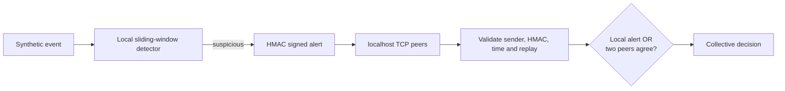

# Collaborative IDS Between Socket Nodes

A small, defensive academic demonstration of collaborative intrusion detection. It runs **four simulated IDS nodes** on `127.0.0.1`; it does not scan hosts, capture packets, or generate real attack traffic.

## What the demonstration keeps

- Real asyncio TCP sockets with length-prefixed JSON messages.
- HMAC-SHA256 authentication, sender checks, freshness validation, replay protection, and malformed-message rejection.
- Transparent sliding-window local detection.
- Collaborative detection using a simple rule: `decision = local_detection OR (two distinct authenticated peers agree)`.
- Reproducible synthetic events, metrics, and a light Streamlit dashboard.

The previous trust-weighted quorum, scale experiments, threshold sweeps, and advanced dashboard pages are no longer part of the normal demonstration flow. Compatibility modules remain in the source so existing low-level tests and result readers are not broken, but they are not used to make the final decision.

## Four scenarios

1. **Normal**: benign activity produces no intrusion decision.
2. **Concentrated**: one node crosses its local threshold.
3. **Distributed**: each node observes only a small portion; the two-peer rule detects the shared incident.
4. **Invalid message**: forged, malformed, stale, and replay-like inputs are rejected before they affect detection.

## Run on Windows PowerShell

```powershell
python -m venv .venv
.venv\Scripts\Activate.ps1
python -m pip install -r requirements.txt
python -m pytest -q
python -m cids.simulation --scenario distributed
streamlit run app.py --server.address 127.0.0.1
```

The dashboard has three sections: **Overview** (four-node topology and totals), **Detection** (scenario decisions), and **Results** (local-only versus collaborative detection and rejected-message counts).

## Message flow



## Limitations

This is a localhost-only simulation with configured node identities and synthetic labels. Two-peer agreement is an easy-to-explain heuristic, not Byzantine consensus; colluding authenticated peers can still mislead it. It is intended for a short academic demonstration, not production deployment.
